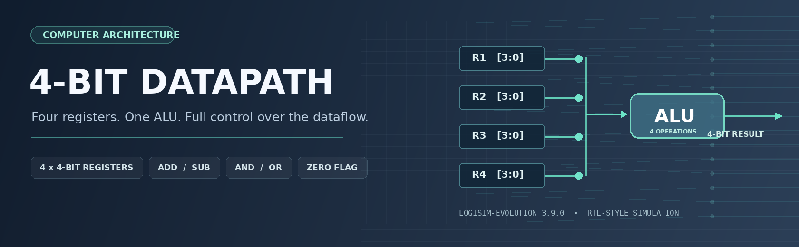
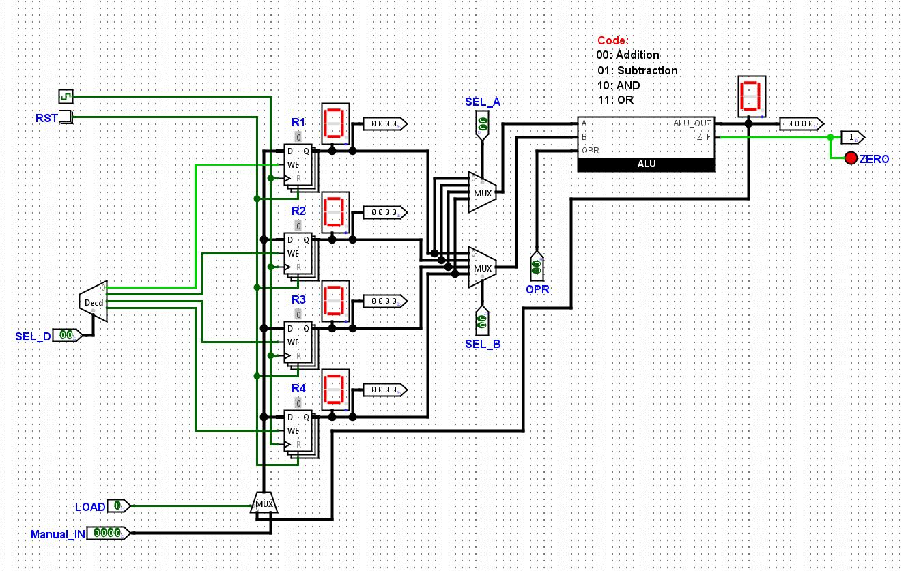
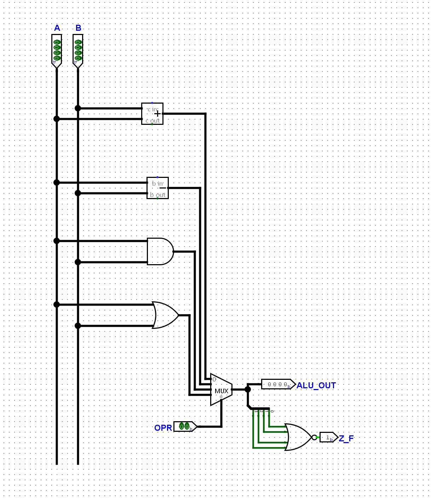
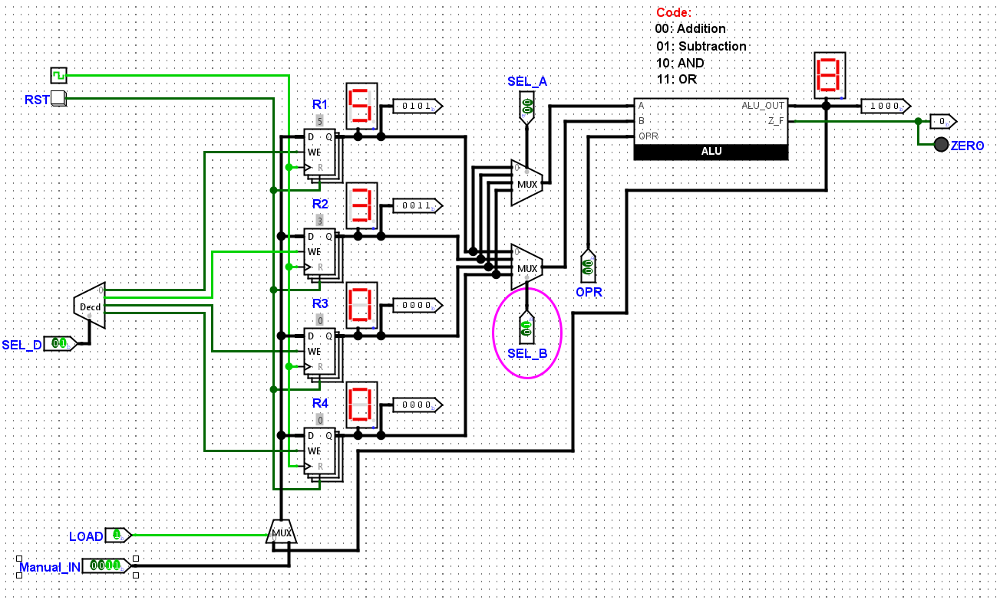
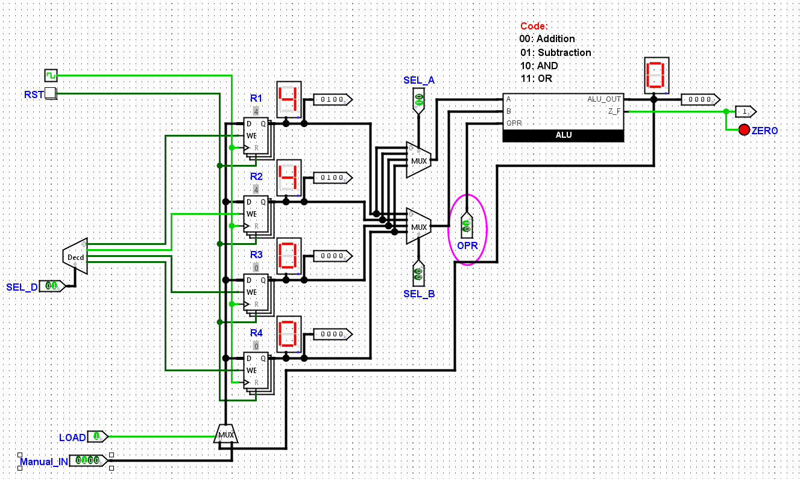

<p align="center">
  
</p>

<h1 align="center">4-Bit Microprocessor Datapath</h1>
<p align="center"><strong>A custom 4-bit digital datapath designed and implemented in Logisim-evolution.</strong></p>
<p align="center"><code>Computer Architecture</code> · <code>Digital Logic</code> · <code>ALU Design</code> · <code>Logisim-evolution</code></p>

---

## Overview

This personal project brings together four 4-bit registers, a custom arithmetic logic unit (ALU), operand-selection multiplexers, destination decoding, and controlled register write-back. The design demonstrates how digital hardware routes, processes, and stores binary data.

### Key features

- **Four 4-bit registers** (`R1`–`R4`) for operand storage.
- **Dual source multiplexers** for independent operand selection.
- **Custom 4-operation ALU** supporting addition, subtraction, AND, and OR.
- **Destination decoder** for selective register updates.
- **Manual input and ALU write-back**, controlled through a shared data path.
- **Zero flag** with a visual LED indicator.

## Circuit design



The two source multiplexers route the selected register values into the ALU. An operation code selects the calculation, while the destination decoder directs the result to the chosen register on the clock edge.

### ALU operations

| `OPR` | Operation | Description |
| :---: | :--- | :--- |
| `00` | **ADD** | 4-bit addition |
| `01` | **SUB** | 4-bit subtraction |
| `10` | **AND** | Bitwise AND |
| `11` | **OR** | Bitwise OR |

The **zero flag** (`ZF`) is asserted when the four-bit ALU output equals `0000`.

<details>
<summary><strong>View the custom ALU subcircuit</strong></summary>



</details>

## Demonstrations

| Example | Output | Zero flag |
| :--- | :---: | :---: |
| `5 + 3` | `8` | `0` |
| `4 - 4` | `0` | `1` |

<p align="center">
  
  <br><sub>Addition example · Result = 8</sub>
</p>

<p align="center">
  
  <br><sub>Zero-result example · ZF = 1</sub>
</p>

## Run the project

1. Install [Logisim-evolution](https://github.com/logisim-evolution/logisim-evolution/releases).
2. Download this repository and open [`circuit/4-bit-microprocessor-datapath.circ`](circuit/4-bit-microprocessor-datapath.circ).
3. Select the **`main`** circuit.
4. Use the **Poke** tool to configure `Manual_IN`, `LOAD`, `SEL_A`, `SEL_B`, `SEL_D`, and `OPR`.
5. Step the clock to update the selected register and observe the output displays and zero flag.

More detail: [Architecture](docs/ARCHITECTURE.md) · [Test cases](docs/VERIFICATION.md) · [Engineering brief (PDF)](docs/engineering-brief.pdf)

Optional circuit structure check: `python tools/check_structure.py`

## Project files

```text
4-bit-microprocessor-datapath/
├── README.md
├── circuit/
│   └── 4-bit-microprocessor-datapath.circ
├── assets/
│   ├── cover.png
│   ├── datapath-overview.png
│   ├── alu-subcircuit.png
│   ├── addition-test.png
│   └── zero-flag-test.png
└── docs/
    ├── ARCHITECTURE.md
    ├── VERIFICATION.md
    └── engineering-brief.pdf
└── tools/
    └── check_structure.py
```

---

<p align="center"><sub>Designed and developed as an independent computer architecture project.</sub></p>
